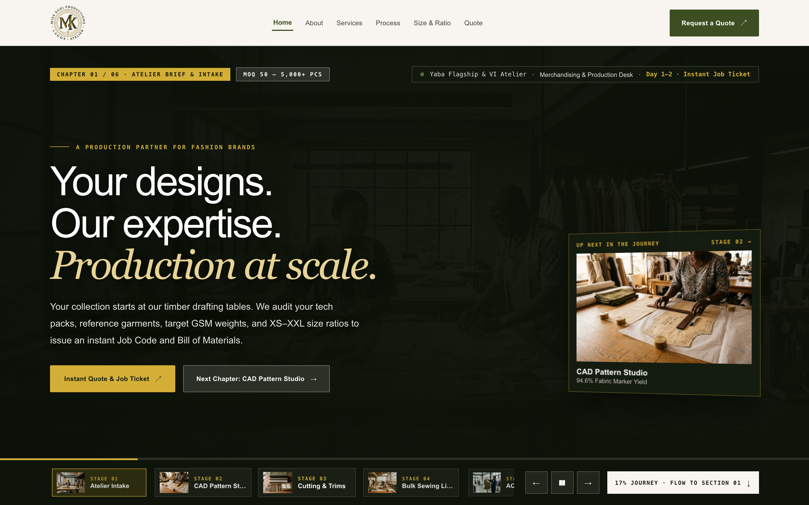
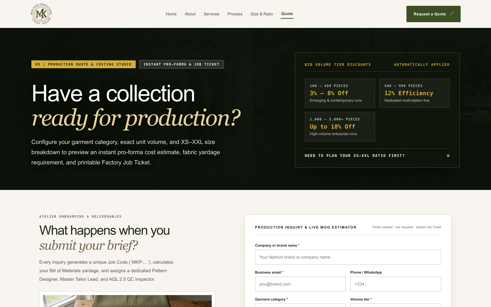
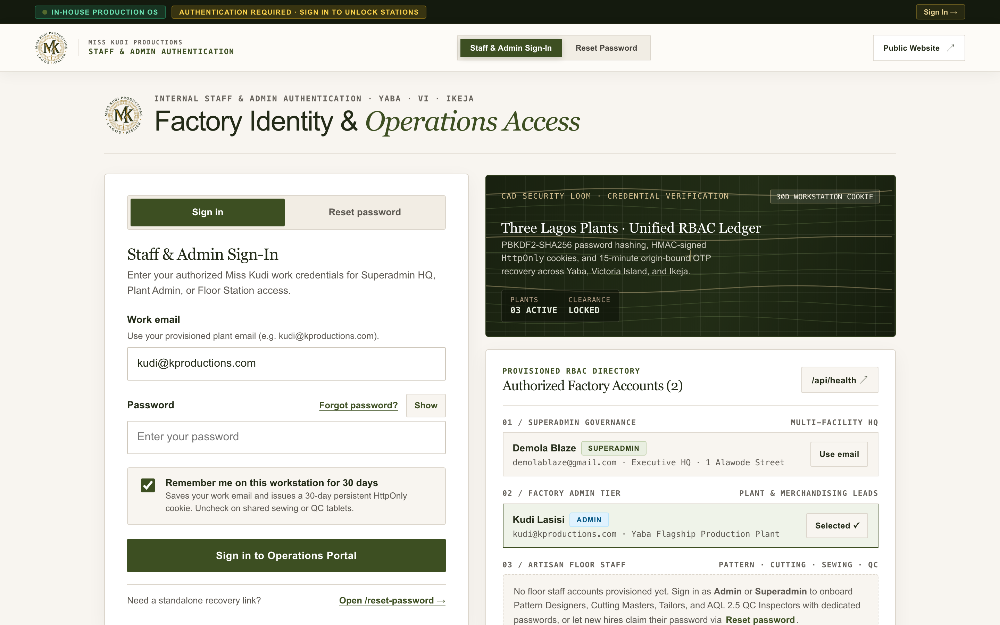
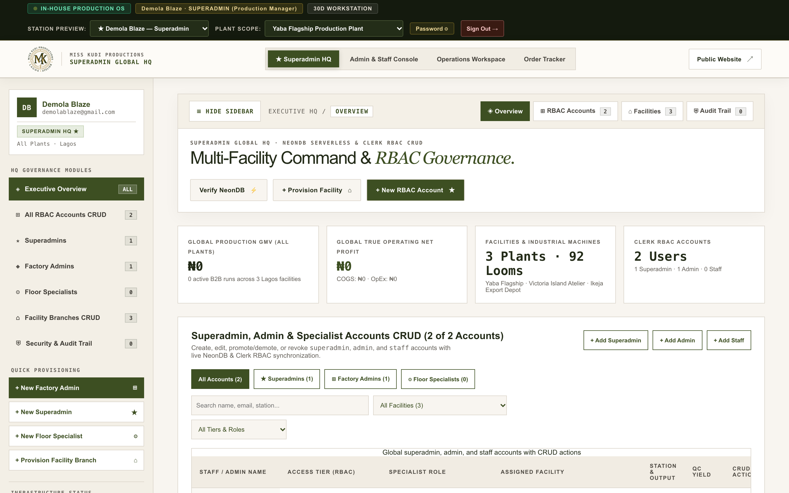
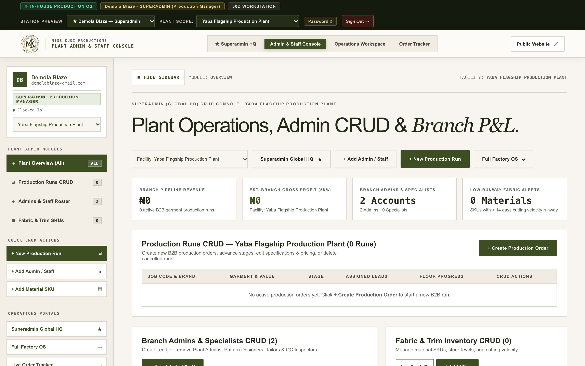
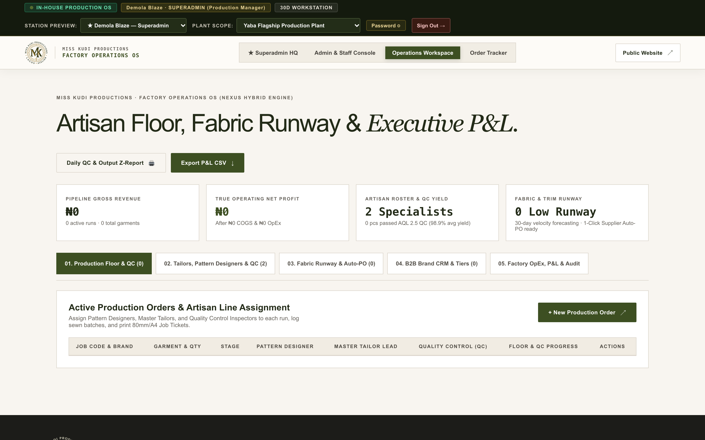
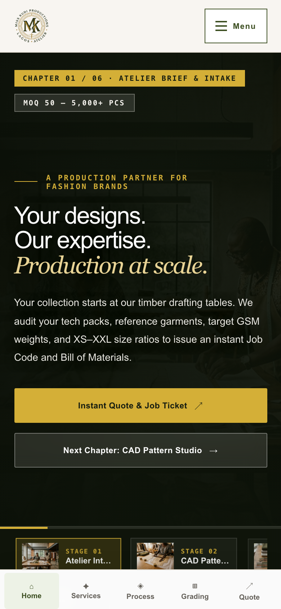
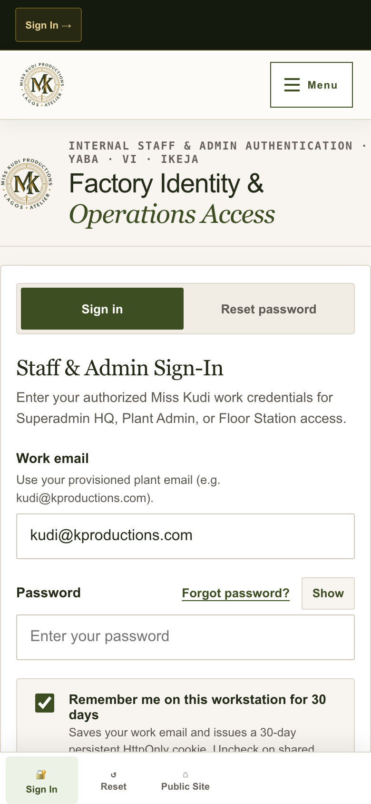
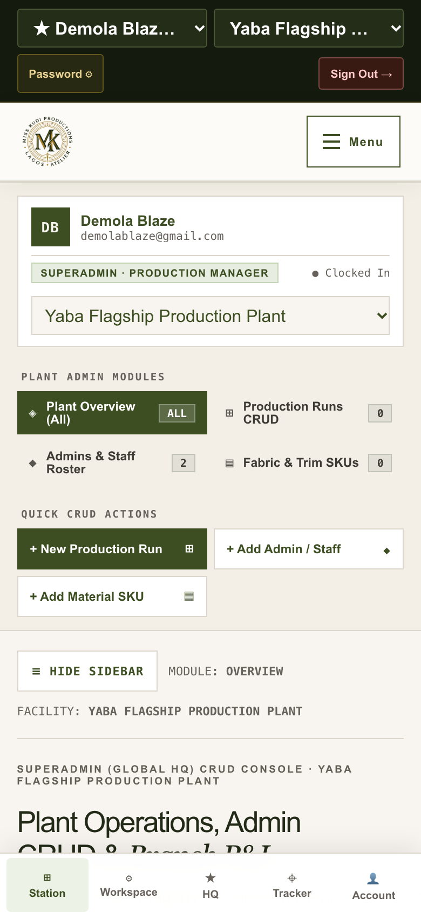

# Miss Kudi Productions — Lagos Garment Manufacturing Atelier

B2B apparel manufacturing platform and production management suite for **Miss Kudi Productions** at **1 Alawode Street, Surulere, Lagos, Nigeria**:
- **Division 01 — Surulere Cut-and-Sew Production Floor** (Bulk cut-and-sew, knitwear, streetwear, corporate uniforms, and structured tailoring lines)
- **Division 02 — CAD Pattern, Grading & Sample Atelier** (Pattern drafting, first-fit sampling, resortwear, and XS to XXL grading)
- **Division 03 — Quality Assurance & Export Finishing Bay** (36-point AQL 2.5 inspection, vacuum steam pressing, private-label tagging, and dispatch)

---

## Application Screenshots

### 1. Public Atelier & Production Quote Studio (Desktop `1440×900`)

| Production Journey Hero (`/`) | MOQ, Yardage & Size Ratio Estimator (`/quote`) |
| --- | --- |
|  |  |

### 2. Staff Sign-In & Production Consoles (Desktop `1440×900`)

| Staff & Plant Manager Sign-In (`/login`) | Executive HQ Console (`/superadmin`) |
| --- | --- |
|  |  |

| Plant Manager & Floor Station (`/dashboard`) | Production Floor, Materials & P&L (`/workspace`) |
| --- | --- |
|  |  |

### 3. Mobile-Responsive Experience (`390×844` Viewport)

| Mobile Atelier Hero (`/`) | Mobile Staff Sign-In (`/login`) | Mobile Plant Console (`/dashboard`) |
| --- | --- | --- |
|  |  |  |

---

## Core Capabilities

### 1. Public Marketing & Costing Studio
- **Editorial Atelier Pages (`/`, `/about`, `/services`, `/process`)**: Full-bleed photography of the Surulere sewing floor, CMT vs. Full-Package (FOB) comparison tables, and 5-stage production milestones.
- **Interactive Size-Grading & Yardage Calculator (`/size-charts`)**: XS to XXL measurement tables in inches and centimeters with roll-yardage calculation (including 5% cutting-table lay allowance).
- **Production Quote Studio (`/quote`) & Order Tracker (`/tracker`)**: Instant pro-forma costing, size breakdown synchronization, and printable 80mm/A4 Factory Job Tickets.

### 2. Staff Access & Production Consoles
- **Executive HQ Console (`/superadmin`)**: Consolidated revenue, COGS, operating expenses, invoicing & official receipts, team roster management, Surulere facility capacity, and audit logs.
- **Plant & Floor Console (`/dashboard`)**: Role-adapted view for Plant Managers (`admin` / `superadmin`) and Floor Specialists (`staff`) covering Pattern Designers, Cutting Masters, Master Tailors, and AQL 2.5 Quality Control Inspectors.
- **Production Workspace (`/workspace`)**: 5-stage order tracking, specialist line assignment, fabric & trim runway monitoring with mill Purchase Orders, B2B brand partner directory, and P&L export.

### 3. Design System (`DESIGN.md` & Hallmark Audit)
- Audited with [Hallmark v2.0](https://github.com/nutlope/hallmark) (`sloplint --genre editorial --kept`: `0 FAIL`, `0 REFLEX`).
- Tokenized design system in [`src/app/tokens.css`](src/app/tokens.css), [`src/app/base.css`](src/app/base.css), and [`src/app/globals.css`](src/app/globals.css) featuring warm linen paper (`#f8f5f0`), warm ivory elevated sheets (`#fdfcf9`), botanical olive ink (`#3d4f22`), `Cormorant Garamond` roman headlines, `Plus Jakarta Sans` UI copy, and `JetBrains Mono` tabular numerals.

---

## Getting Started

### 1. Install Dependencies

```bash
npm install
```

### 2. Configure Environment Variables (Optional for Local Mode)

Create `.env.local` in the project root if connecting to PostgreSQL:

```bash
DATABASE_URL="postgresql://<user>:<password>@<postgres-host>/<dbname>?sslmode=require"
AUTH_SESSION_SECRET="<32+-byte-random-hex-secret>"
```

### 3. Initialize Database Schema (When `DATABASE_URL` Is Set)

```bash
npm run db:init
```

### 4. Start Development Server

```bash
npm run dev
```

Open `http://localhost:3000` to view the atelier site, or `http://localhost:3000/login` to access the production consoles.

---

## Project Scripts

| Command | Description |
| --- | --- |
| `npm run dev` | Start development server |
| `npm run build` | Compile production bundle and type-check all routes |
| `npm run start` | Run compiled production server |
| `npm run db:init` | Provision database tables from `db/schema.sql` |
| `npm run lint` | Run ESLint across `src/` |
